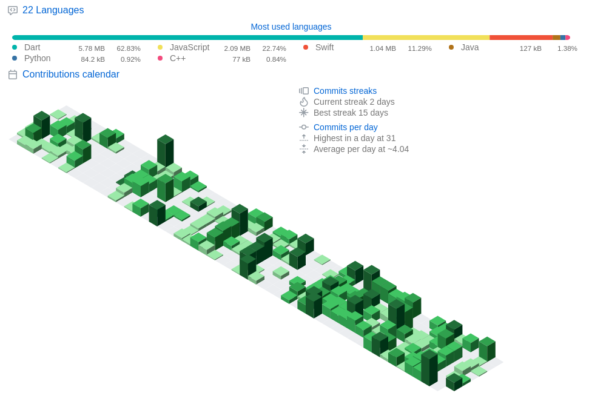

# Yusuf Kerem Alçiçek

**adım adım daha iyisi.**

 

 

## About

<table>
<tr>
<td width="62%" valign="top">
<strong>Full stack, from the interface inward.</strong>
  
Computer engineering at <a href="https://www.yusufalcicek.me/#about">Kocaeli University</a>. I ship web, mobile, and desktop products, and I count the screen, the architecture, and the performance as one piece of work.
  
The path was short and deliberate. C first, for the habit of thinking a problem through. Then React and the web. Then products that leave the browser: desktop, mobile, macOS. Learning stays part of the job.
</td>
<td width="38%" valign="top">
<strong>Education</strong> 
Kocaeli University · B.Sc. Computer Engineering 
October 2023 — Present
  
<strong>Experience</strong> 
TNC Group · Software Development Intern 
Software Persona · Software Development Intern
  
<strong>On every project</strong> 

</td>
</tr>
</table>

 

## Stack

Logos for the tools on the site, plus Swift and Flutter from the shipped apps.

 

## Selected work

The same projects, written up on the [portfolio](https://www.yusufalcicek.me/). Language and last update below come live from each repository.

<table>
<tr>
<td width="50%" valign="top">

**[Orange](https://github.com/MachineX41/Orange-App)** · macOS

A local file studio for Apple silicon. Convert, edit, and move files where you drop them. Nothing is uploaded.

</td>
<td width="50%" valign="top">

**[TimeCraft](https://github.com/MachineX41/TimeCraft)** · Web

Time, rate, and project tracking for freelancers. One dashboard, live metrics.
[Open the demo](https://timecraftt.netlify.app/)

</td>
</tr>
<tr>
<td width="50%" valign="top">

**[VeloCatalog](https://github.com/MachineX41/VeloCatalog)** · Flutter

A product catalog with search, filters, and a cart, laid out like a store.

</td>
<td width="50%" valign="top">

**[Diabetes Tracking](https://github.com/MachineX41/Diabetes-Tracking-System)** · Desktop

Daily health logs for patients, a live view for doctors, and automatic recommendations.

</td>
</tr>
<tr>
<td width="50%" valign="top">

**[İzmit Transit Routes](https://github.com/MachineX41/Toplu-Tasima-Rotalari)** · Web

Hybrid routing across bus, tram, and taxi in İzmit. Cost, time, and transfers in one result.

</td>
<td width="50%" valign="top">

**[Author Graph](https://github.com/MachineX41/authors-and-collaboration-analysis--graph-structure-)** · Python

Academic collaboration as a graph: authors as nodes, shared papers as edges.

</td>
</tr>
</table>

Also public: [WarriorCards](https://github.com/MachineX41/WarriorCards), a Java strategy card game, and a small [rate limiting and CORS demo](https://github.com/MachineX41/API-Gu-venlig-i-Rate-Limiting-CORS-demo).

 

## Activity

Streak beside the year graph, and the 3D calendar underneath. All of it is read from GitHub.

<table>
<tr>
<td width="46%" align="center" valign="middle">

</td>
<td width="54%" align="center" valign="middle">

</td>
</tr>
</table>

 

Open to internships and collaborations.
[yusufalcicek.me](https://www.yusufalcicek.me/) · [yusufalcicekdev@gmail.com](mailto:yusufalcicekdev@gmail.com)

